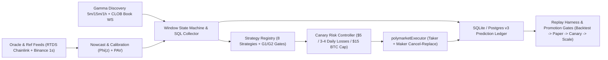

# BTC Up/Down Polymarket Prediction Engine — Master Specification

- **Feature slug:** `btc-updown-prediction-engine`
- **Target category:** Polymarket Bitcoin Up/Down (`5m`, `15m`, `1h`)
- **Mandatory promotion lifecycle:** `Backtest (collected real windows + out-of-sample replay) -> Paper (shadow intents on live CLOB books) -> Canary Live -> Scale`
- **Status:** Orchestrated (`Wave 0` prerequisite UI/build fix followed by `Waves 1-4` engine delivery)

---

## 1. Objective & Honest KPI Definition

A raw **>90% win rate** on Polymarket binary Up/Down markets is trivial to achieve by buying favorites priced at 90-97 cents, because price already tracks probability. The binding profitability threshold is **net edge per share after fees**:

```text
net_edge_per_share = p_realized - ask - fee_per_share
```

Using `POLYMARKET_FEES.crypto` in `src/predictionMarket.ts` (`takerFeeRate = 0.07`, `makerRebateShare = 0.20`, where `taker_fee = 0.07 * p * (1 - p)`):

| Entry price | Taker fee / share | Break-even win rate | 1 loss erases |
|---:|---:|---:|---:|
| `0.50` | `1.75c` | `51.8%` | ~1 win |
| `0.80` | `1.12c` | `81.1%` | ~4 wins |
| `0.90` | `0.63c` | `90.6%` | ~10 wins |
| `0.95` | `0.33c` | `95.3%` | ~20 wins |
| `0.97` | `0.20c` | `97.2%` | ~35 wins |

Because high-win-rate strategies have asymmetric left-tail payoff (`-0.95` vs `+0.05`) while moderate-win-rate maker/carry strategies drive higher expected PnL per dollar risked, the engine separates into **two complementary lanes**:

1. **High-Hit-Rate Lane (`>90%` realized hit rate target):** `c5-late-favorite`, `c15-late-favorite-guarded`, `c1h-late-nowcast`.
2. **Edge Lane (`50-87%` realized hit rate, primary dollar PnL engine):** `c5-nowcast-maker`, `c15-favorite-carry`, `c1h-exhaustion-limit`, `cx-nested-coherence`, `c5-15-longshot-fade`.

Every strategy—regardless of lane—must satisfy all **Promotion Gates** before advancing from `Backtest -> Paper -> Canary Live -> Scale`:

- Minimum sample size: `n >= 500` independent settled windows.
- Statistical confidence: Wilson 95% lower bound (`computeWilsonLowerBoundPct`) strictly `>= avg_break_even_win_rate + 1.0pp`.
- Positive out-of-sample net PnL after fees (`polymarketFeePerShare`) and observed half-spread.
- Maker / active fill quality: 30-fill `+30s` markout `>= -2.0c`.

---

## 2. Repository Evidence Baseline & Exclusions

Verified against `docs/PREDICTION_MARKET_PLAYBOOK.md` and `src/predictionStrategies.ts`:

- **5m 90-100c bucket:** realized `98.9%` vs `95.3%` mean entry (`+3.6pp`, `n = 89`). Favorites are underpriced.
- **15m 90-100c bucket:** realized `95.4%` vs `96.5%` mean entry (`n = 151`). Blindly buying 15m favorites loses money after fees; requires strict positive mispricing guard.
- **15m 70-80c bucket:** realized `87.2%` vs `74.6%` mean entry (`+12.6pp`, `n = 78`).
- **5m & 15m 20-30c buckets:** realized `17.2%` on 5m (`-7.9pp`, `n = 87`) and `16.9%` on 15m (`-8.2pp`, `n = 118`). Longshots are consistently rich.
- **1h exhaustion setup:** `3+` consecutive red hours or `RSI(14) < 35` resolved UP `54.7-55.9%` on Binance (`n = 383..1,901`), viable only with limit `<= 0.52` outside macro windows.
- **Nowcast calibration advantage:** TWAP nowcast achieved lower Brier score than CLOB market prices (`0.144` vs `0.152` measured).
- **Mandatory `avoid` exclusions enforced in runtime code:**
  - Never execute directional taker trades in the first `60s` (`[T, T+60s]`) on `5m` or `15m` (`c5-open-ignore`).
  - Never route Binance candle-indicator taker bots (`prev red`, `RSI < 30`, `ATR shock`) into `5m` or `15m` Polymarket Up/Down contracts (`48.2%` UP on 5m `n=110`; `47.1%` UP on 15m `n=17`) (`c15-signal-avoid`).
  - **20 custom FLARE rules in `src/predictions.ts` (and `STRATEGY_PRESETS` #6/#7/#8 in `src/botEngine.ts`):** These evaluate custom FLARE synthetic questions (e.g., "closes below SMA 20", "breaks Inside Bar high/low") on Binance candles. They are **not** Polymarket Up/Down contracts and must be clearly labeled `Research / Custom Signal Only` in the UI and blocked from live Polymarket Up/Down execution.

---

## 3. Oracle & Market Data Architecture

Zero paid Chainlink Data Streams credentials are required:

1. **Primary Chainlink Oracle Stream — Polymarket Public RTDS WebSocket:**
   - Endpoint: `wss://ws-live-data.polymarket.com` (public, unauthenticated).
   - Heartbeat: send text frame `PING` every `5,000ms`; detect silent dead sockets and reconnect with exponential backoff + jitter without losing buffered state.
   - Subscription payload:
     ```json
     {
       "action": "subscribe",
       "subscriptions": [
         {
           "topic": "crypto_prices_chainlink",
           "type": "*",
           "filters": "{\"symbol\":\"btc/usd\"}"
         }
       ]
     }
     ```
   - Maintain a rolling `60s` time-weighted average (`TWAP-60s`) buffer in memory so `S0` (window-open reference TWAP) and `St` (live TWAP) match Polymarket's Chainlink settlement rule, even through brief 1-2s upstream RTDS tick gaps.
2. **Secondary Reference & Volatility Stream — Binance Public `aggTrade` + MarketGateway:**
   - Stream: `wss://stream.binance.com:9443/ws/btcusdt@aggTrade` downsampled into `1s` bars, paired with `src/server/marketData/marketGateway.ts` for `1m` / `1h` closed candles.
   - Supplies 1m log-return realized volatility `sigma` (floored at `0.35 * median_24h_sigma`), 1h RSI/red-bar exhaustion counts, and live basis validation against the Chainlink oracle.
3. **Per-Market Resolution Source Verification:**
   - Gamma market discovery (`src/server/polymarketAdapter.ts`) must parse each market's `resolutionSource` / `description` text into `'chainlink-twap-60s' | 'binance-1h-candle' | 'unknown'`.
   - `1h` slug discovery uses Eastern Time ET hour-slug mapping and Gamma search fallback so active hourly markets resolve reliably alongside `5m` and `15m`.
   - When `resolutionSource === 'unknown'`, gate `G2` fails closed (collection still records the window, live/paper execution stands down).
4. **Live CLOB Order Book Feed:**
   - Combines CLOB REST `/book?token_id=...` hydration and CLOB Market WebSocket (`wss://ws-subscriptions-clob.polymarket.com/ws/market`) to maintain top-5 YES/NO bids & asks, USD depth, spread in cents, and quote age (`asOfMs`) for every active window.

---

## 4. Orchestrated Strategy Portfolio (8 Strategies + 2 Always-On Gates)

| # | ID | TF | Lane | Entry Mechanic | Exit / Cancel Rule | Expected Hit Rate | Start Mode |
|---:|---|---|---|---|---|---:|---|
| 1 | `c5-late-favorite` | `5m` | Hit-rate | Window remaining `30s..120s`. `P_model >= 0.94`, `ask <= P_model - 0.02`, `ask <= 0.97`, spread `<= 3c`, depth `>= $200` | Hold to resolution; no mid-window stop | `95-98%` | `paper` |
| 2 | `c5-nowcast-maker` | `5m` | Edge | Remaining `90s..240s`, `|z| <= 2.5`. `P_quote = 0.75*P_model + 0.25*mid`. Post maker YES/NO bids inside `P_quote - buffer - spread/2` where `buffer = max(0.015, 0.35*fee)`; taker override only if `|P_model - ask| >= 0.10`, age `<= 10s`, depth `>= 3x` clip | Cancel all open resting quotes at `T-20s`; no cross-window carry | `50-65%` | `paper` |
| 3 | `c15-favorite-carry` | `15m` | Edge | Remaining `>= 300s`. Side ask in `[0.70, 0.88]`, `ask <= P_model - 0.04`, spread `<= 3c`, depth `>= $200` | Hold to resolution; do not double down on losing window | `85-87%` | `paper` |
| 4 | `c15-late-favorite-guarded` | `15m` | Hit-rate | Remaining `45s..180s`. `P_model >= 0.94`, `ask <= 0.96`, AND strict mispricing floor `P_model - ask >= 0.04` (guards against overpriced 15m 90-100c bucket) | Hold to resolution | `93-96%` | `research` |
| 5 | `c1h-late-nowcast` | `1h` | Hit-rate | Final `10m` of the 1h window (`60s..600s` remaining), `|z| >= 2.0`, `P_model >= 0.93`, `ask <= P_model - 0.02`, `ask <= 0.97`; oracle matched to window's parsed resolution source | Cancel unfilled at `T-30s`; hold filled to resolution | `93-97%` | `research` |
| 6 | `c1h-exhaustion-limit` | `1h` | Edge | `>= 3` consecutive red closed `1h` bars OR `RSI(14) < 35`; buy UP limit only at `price <= 0.52` (reject if `ask > 0.54` or spread `> 3c`) | Cancel unfilled limit at `T+10m`; hold fills to resolution | `~55%` | `paper` |
| 7 | `cx-nested-coherence` | `5m`/`15m`/`1h` | Edge | Parent (`15m`/`1h`) and active child (`5m`/`15m`) share one underlying BTC path; compute joint conditional probability `P(child | St, parent)` and buy whichever leg disagrees with joint fair value by `>= 4c` | Hold to earliest window expiry or cancel at `T-30s` | `70-90%` | `research` |
| 8 | `c5-15-longshot-fade` | `5m`/`15m` | Edge | Opposite-side bias capture: when the 20-30c longshot side has `bid >= P_model_side + 0.05` (overpriced lottery flow), buy the favorite opposite side at `70-80c` (`ask <= P_model_fav - 0.03`) | Hold to resolution | `78-82%` | `paper` |

### Always-On Safety Gates

- **`G1` Regime & Microstructure Gate:**
  - Rejects all entries within `+-30 minutes` of configured macro blackout timestamps (FOMC, CPI, NFP).
  - Rejects when `sigma1m > 3 * median24hSigma`.
  - Rejects when displayed top-of-book depth `< $200` (`minDepthUsd`), bid-ask spread `> 3c` (`maxSpread = 0.03`), or quote age `> 10s`.
- **`G2` Oracle & Basis Integrity Gate:**
  - Rejects when the active oracle feed for the window is stale (`> 15s` since last tick).
  - Rejects when Chainlink/Binance spot basis divergence `|oraclePrice - binancePrice| / binancePrice > 25 bps` (`0.0025`).
  - Rejects when `resolutionSource === 'unknown'`.

---

## 5. Canary Capital & Risk Budget (Operator-Approved)

- **Canary ticket stake:** fixed **`$5.00` USD per trade** (`canaryStakeUsd = 5`), overriding Kelly sizing upwards during canary phase (Kelly can size smaller if edge is small, never above `$5.00`).
- **Daily loss circuit breaker:** max **`3-4` losing trades per UTC day** (`maxDailyLosses = 3` default, operator-configurable between `3` and `4` in Settings / Engine UI), enforcing a **`$15.00-$20.00` USD/day** hard realized loss limit (`maxDailyLossUsd = maxDailyLosses * 5`).
- **BTC Single-Factor Exposure Cap:** max **`$15.00` USD open simultaneously** (`maxConcurrentBtcExposureUsd = 15`, i.e., max 3 open `$5` tickets across `5m + 15m + 1h` combined), preventing correlated BTC spikes from tripping more than the daily loss budget on a single candle.
- **Global & Per-Strategy Kill-Switches:** integrated with `registerKillSwitchHandler` in `src/server/exchangeAdapter.ts` so engaging the FLARE Emergency Kill-Switch immediately calls `cancelAllPolymarketOrders()` and freezes the intra-window runner.

---

## 6. Architecture & Reuse Map



### Existing Modules Reused vs. New Modules

| Component | Existing Module | New / Extended Work |
|---|---|---|
| Live CLOB execution, dual-key arming, ledger, kill-switch | `src/server/polymarketExecutor.ts` | Add limit post-only resting quote placement, cancel/replace, and scheduled T-20s/T-90s open-order cancellation sweep |
| Exchange risk & kill-switch bus | `src/server/exchangeAdapter.ts` | Shared tenant kill-switch broadcast & UTC-day loss/count enforcement |
| Executable quote validation | `src/market/quoteService.ts` | Extend `buildQuoteFromPolymarketWindow` & live book adapter with depth (`top5DepthUsd`) and stale checks |
| Market data & `1m`/`1h` bars | `src/server/marketData/marketGateway.ts` | Reused for 1h exhaustion indicators and 24h median volatility baseline |
| Polymarket Gamma discovery | `src/server/polymarketAdapter.ts` | **Ticket `03`:** add `'1h'` timeframe slugs, `resolutionSource` parser, and `clobBookFeed.ts` |
| SQL ACID storage (`node:sqlite` + Postgres/Timescale) | `src/server/store/*` | **Ticket `04`:** schema migration `v3` + `prediction_windows`, `prediction_window_snapshots`, `prediction_shadow_trades`, `prediction_strategy_states` |
| Oracle TWAP & Binance 1s feed | — | **Ticket `02`:** `src/server/prediction/oracleFeed.ts` |
| Pure math (nowcast, isotonic calibration, replay harness) | `src/predictionMarket.ts` | **Ticket `05`:** `src/prediction/nowcast.ts`, `src/prediction/calibration.ts`, `src/prediction/replayHarness.ts` |
| 8-strategy registry, G1/G2 gates & canary risk | — | **Ticket `06`:** `src/prediction/engine/{types,gates,strategies,promotion}.ts` |
| Intra-window runner (`1-2s` loop) | — | **Ticket `07`:** `src/server/prediction/predictionRunner.ts` |
| Bot API & UI | `src/server/botRuntime.ts`, `src/api/botClient.ts`, `src/pages/Predictions.tsx` | **Ticket `01` (BotConfig/Settings prerequisite) + Ticket `08` (Engine API & UI tab)** |

---

## 7. Shared Domain Contracts

All new files must follow TypeScript 7 compiler flags (`verbatimModuleSyntax: true`, `erasableSyntaxOnly: true` -> use `type` unions and `import type`, never `enum`), inject clock/fetch/WebSocket/CLOB dependencies for deterministic tests, and never invent simulated market prices in runtime paths.

### 7.1 SQL Migration `v3` (`SQLITE_MIGRATIONS` & `POSTGRES_MIGRATIONS`)

- **`prediction_windows`:** `slug` (PK), `timeframe` (`'5m'|'15m'|'1h'`), `condition_id`, `up_token_id`, `down_token_id`, `resolution_source` (`'chainlink-twap-60s'|'binance-1h-candle'|'unknown'`), `start_time_ms`, `end_time_ms`, `open_twap`, `close_twap`, `resolved_up` (`NULL|0|1` or `BOOLEAN`), `tick_size`, `neg_risk`, `volume_usd`, `updated_at`.
- **`prediction_window_snapshots`:** `id` / auto key, `slug`, `captured_at_ms`, `seconds_remaining`, `twap_price`, `binance_price`, `sigma_1m`, `basis_bps`, `yes_bid`, `yes_ask`, `yes_depth_usd`, `no_bid`, `no_ask`, `no_depth_usd`, `p_model_yes`, `UNIQUE(slug, captured_at_ms)`.
- **`prediction_shadow_trades`:** `id` (PK), `tenant_id`, `strategy_id`, `lane`, `mode` (`'paper'|'canary'|'scale'`), `slug`, `timeframe`, `outcome` (`'YES'|'NO'`), `liquidity_role` (`'taker'|'maker'`), `entry_time_ms`, `entry_price`, `fee_usd`, `stake_usd`, `shares`, `p_model`, `p_calibrated`, `markout_30s`, `resolved_up`, `won`, `net_pnl_usd`, `venue_order_id`, `status` (`'OPEN'|'SETTLED'|'CANCELED'`).
- **`prediction_strategy_states`:** `tenant_id`, `strategy_id`, `mode` (`'disabled'|'paper'|'canary'|'scale'`), `halted_reason`, `updated_at`, `PRIMARY KEY (tenant_id, strategy_id)`.

---

## 8. Delivery Waves & Conflict-Free File Ownership

- **Wave 0 (`Ticket 01`):** Fix broken build (`src/App.tsx` vs `src/pages/Settings.tsx`) + finish customizable `BotConfig.tsx` & `Settings.tsx` + tests & `impeccable detect` check -> **commit green baseline to `master`**.
- **Wave 1 (`Tickets 02, 03, 05` — 3 parallel workers, `workspace: "share"`):** Zero file overlap. Builds Oracle+Binance 1s feed, Polymarket 1h discovery+CLOB book feed, and pure Nowcast+Calibration+Replay math.
- **Wave 2 (`Tickets 04, 06` — 2 parallel workers, `workspace: "share"`):** Zero file overlap. Builds SQL v3 store + continuous Window Collector (`04`), and the 8-strategy Engine + G1/G2 Gates + Promotion/Canary Risk (`06`).
- **Wave 3 (`Ticket 07` — 1 worker):** Wires Maker CLOB support (`polymarketExecutor.ts`) and builds the 1-2s `predictionRunner.ts` combining `02 + 03 + 04 + 06`.
- **Wave 4 (`Ticket 08` — 1 worker):** Exposes `/api/prediction-engine/*` in `botRuntime.ts` / `botClient.ts`, adds the live Engine Dashboard & Replay Runner to `src/pages/Predictions.tsx`, and relabels the legacy 20 FLARE rules as research-only.

Look at [swarm-plan.md](file:///c:/Users/Bitbase/OneDrive/Documents/BITBASE/FLARE/.scratch/btc-updown-prediction-engine/swarm-plan.md) for the exact wave merge instructions and copy-ready worker briefs.
