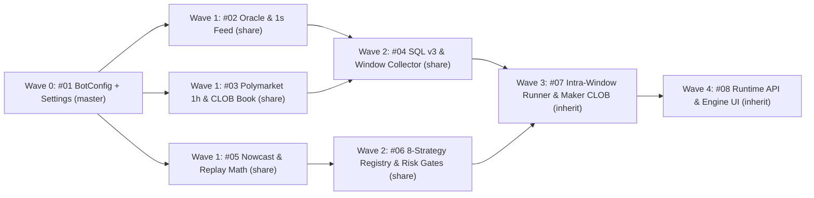

# Swarm Orchestration Playbook — Bot Customization & BTC Up/Down Prediction Engine

Execute work in strict dependency waves so parallel agents modify **disjoint files** and never collide. After each wave completes, merge shared workspaces into `master` (if `workspace: "share"` was used) and run the **Sequential Gate** before spawning the next wave:

```powershell
npm run build ; npm run lint ; npm test
```

> **Windows rule:** Run `build`, `lint`, and `test` one after another (never concurrently in separate shells) to avoid transient Vitest/Rolldown `EPERM` lock errors.

---

## 1. Execution Dependency DAG



---

## 2. Conflict-Free Parallel File Matrix

| Wave | Workers | Exclusive Owned Paths (Zero Overlap) |
|---|---|---|
| **Wave 0** | `ui-setup` (`inherit`) | `src/pages/BotConfig.tsx`, `src/pages/Settings.tsx`, `src/i18n.tsx`, `src/settings.test.ts`, `src/botConfig.test.ts` |
| **Wave 1** | `oracle-feed` (`share`) | `src/server/prediction/oracleFeed.ts`, `src/server/prediction/oracleFeed.test.ts` |
| **Wave 1** | `poly-book` (`share`) | `src/server/polymarketAdapter.ts`, `src/server/polymarketAdapter.test.ts`, `src/server/prediction/clobBookFeed.ts`, `src/server/prediction/clobBookFeed.test.ts` |
| **Wave 1** | `nowcast-math` (`share`) | `src/prediction/nowcast.ts`, `src/prediction/calibration.ts`, `src/prediction/replayHarness.ts`, `src/prediction/nowcast.test.ts`, `src/prediction/replayHarness.test.ts` |
| **Wave 2** | `sql-collector` (`share`) | `src/server/store/types.ts`, `src/server/store/sqliteStore.ts`, `src/server/store/postgresMigrations.ts`, `src/server/store/postgresStore.ts`, `src/server/store/store.test.ts`, `src/server/prediction/windowCollector.ts`, `src/server/prediction/windowCollector.test.ts` |
| **Wave 2** | `strategy-core` (`share`) | `src/prediction/engine/types.ts`, `src/prediction/engine/gates.ts`, `src/prediction/engine/strategies.ts`, `src/prediction/engine/promotion.ts`, `src/prediction/engine/strategies.test.ts` |
| **Wave 3** | `intra-runner` (`inherit`) | `src/server/polymarketExecutor.ts`, `src/server/polymarketExecutor.test.ts`, `src/server/prediction/predictionRunner.ts`, `src/server/prediction/predictionRunner.test.ts` |
| **Wave 4** | `engine-ui` (`inherit`) | `src/server/botRuntime.ts`, `src/api/botClient.ts`, `src/pages/Predictions.tsx`, `src/i18n.tsx`, `src/server/prediction/predictionApi.test.ts` |

---

## 3. Copy-Ready Worker Briefs

### Wave 0 (Run First & Commit)

- **`ui-setup`** (`workspace: "inherit"`):
  > Read `.scratch/btc-updown-prediction-engine/issues/01-finish-bot-setup-and-settings.md` and `src/App.tsx` (fix the TS2322 error at line 199). Finish `src/pages/BotConfig.tsx`, `src/pages/Settings.tsx`, `src/i18n.tsx`, plus `src/settings.test.ts` and `src/botConfig.test.ts`. Run `impeccable.cmd detect --json src/pages/BotConfig.tsx src/pages/Settings.tsx`, then sequentially verify `npm run build`, `npm run lint`, and `npm test`. Update issue #01 status and summarize modified files.

---

### Wave 1 (Launch 3 Workers in Parallel after Wave 0 merges & passes)

- **`oracle-feed`** (`workspace: "share"`):
  > Own ONLY `src/server/prediction/oracleFeed.ts` and `src/server/prediction/oracleFeed.test.ts` (do not edit shared files). Read `.scratch/btc-updown-prediction-engine/spec.md` and `issues/02-oracle-and-binance-1s-feed.md`. Implement Polymarket public RTDS Chainlink `btc/usd` WS with 5s `PING` and 60s TWAP buffer, Binance public `aggTrade` 1s reference stream, 1m realized volatility (`sigma` + `0.35 * median24h` floor), and `basisBps`. Add unit tests with injected mock WS/fetch and verify `npm run build`, `npm run lint`, `npm test`.

- **`poly-book`** (`workspace: "share"`):
  > Own ONLY `src/server/polymarketAdapter.ts`, `src/server/polymarketAdapter.test.ts`, `src/server/prediction/clobBookFeed.ts`, and `src/server/prediction/clobBookFeed.test.ts` (verify `src/server/botRuntime.ts` and `src/pages/Predictions.tsx` still typecheck cleanly with `'1h'` added to `PolymarketTimeframe`). Read `.scratch/btc-updown-prediction-engine/spec.md` and `issues/03-polymarket-1h-discovery-and-clob-book.md`. Implement 1h Gamma discovery, `resolutionSource` classification, top-5 CLOB order-book WS/REST feed, and `toExecutableQuote`. Verify sequentially with `npm run build`, `npm run lint`, `npm test`.

- **`nowcast-math`** (`workspace: "share"`):
  > Own ONLY `src/prediction/nowcast.ts`, `src/prediction/calibration.ts`, `src/prediction/replayHarness.ts`, `src/prediction/nowcast.test.ts`, and `src/prediction/replayHarness.test.ts`. Read `.scratch/btc-updown-prediction-engine/spec.md`, `src/predictionMarket.ts`, and `issues/05-nowcast-calibration-and-replay-harness.md`. Implement `normalCdf`, `computeNowcast`, nested `5m`/`15m`/`1h` joint conditional pricing, out-of-sample PAV isotonic calibration, Brier comparison, and deterministic `runWindowReplay` + `PromotionReport`. Verify sequentially with `npm run build`, `npm run lint`, `npm test`.

---

### Wave 2 (Merge Wave 1, verify `build`/`lint`/`test`, then Launch 2 Workers in Parallel)

- **`sql-collector`** (`workspace: "share"`):
  > Own `src/server/store/{types,sqliteStore,postgresMigrations,postgresStore,store.test}.ts` and `src/server/prediction/{windowCollector,windowCollector.test}.ts`. Read `.scratch/btc-updown-prediction-engine/spec.md` and `issues/04-sql-window-collector-and-resolution-ledger.md`. Add SQL migration `v3` tables across SQLite & Postgres, implement typed `StateStore` CRUD methods, and implement the continuous `5m`/`15m`/`1h` `PredictionWindowCollector`. Verify sequentially with `npm run build`, `npm run lint`, `npm test`.

- **`strategy-core`** (`workspace: "share"`):
  > Own ONLY `src/prediction/engine/{types,gates,strategies,promotion,strategies.test}.ts`. Read `.scratch/btc-updown-prediction-engine/spec.md`, `src/predictionStrategies.ts`, `src/predictions.ts`, and `issues/06-strategy-registry-and-risk-gates.md`. Implement all 8 strategies, always-on `G1`/`G2` gates, explicit `avoid` rules (first-60s block + 20 custom FLARE research exclusion), promotion gate enforcement (`n >= 500`, `wilsonLB >= BE + 1pp`, `+30s` markout), and canary risk controller (`$5`/trade, `3-4` losses/day, `$15` BTC factor cap). Verify sequentially with `npm run build`, `npm run lint`, `npm test`.

---

### Wave 3 (Merge Wave 2, verify `build`/`lint`/`test`, then Launch 1 Worker)

- **`intra-runner`** (`workspace: "inherit"`):
  > Own `src/server/polymarketExecutor.ts`, `src/server/polymarketExecutor.test.ts`, `src/server/prediction/predictionRunner.ts`, and `src/server/prediction/predictionRunner.test.ts`. Read `issues/07-intrawindow-runner-and-maker-executor.md`. Add maker GTC post/cancel-by-window (`cancelOrdersForWindow`) to `polymarketExecutor.ts` and implement the 1-2s intra-window runner managing `Backtest -> Paper -> Canary -> Scale` execution, `T-20s`/`T-90s` sweeps, `+30s` markout capture, settlement, and restart hydration. Verify sequentially with `npm run build`, `npm run lint`, `npm test`.

---

### Wave 4 (Verify Wave 3, then Launch 1 Worker & Commit)

- **`engine-ui`** (`workspace: "inherit"`):
  > Own `src/server/botRuntime.ts`, `src/api/botClient.ts`, `src/pages/Predictions.tsx`, `src/i18n.tsx`, and `src/server/prediction/predictionApi.test.ts`. Read `issues/08-runtime-api-and-prediction-engine-ui.md`. Mount `/api/prediction-engine/*` with RBAC + tenant scoping, wire the collector/runner lifecycle into `botRuntime.ts`, add typed `botClient` wrappers, add the Engine Orchestrator tab + `1h` support in `Predictions.tsx`, and relabel the legacy 20 FLARE rules tab as Research-only. Run `impeccable.cmd detect --json src/pages/Predictions.tsx`, then verify sequentially with `npm run build`, `npm run lint`, `npm test`.

---

## 4. Cleanup After Swarm Finishes

After all waves pass on `master`, follow the coordinator lifecycle rule:
1. Confirm every shared worker's changes are merged/cherry-picked cleanly into `master`.
2. Verify `git status --short`, `npm run build`, `npm run lint`, `npm test`.
3. `kill` finished swarm workers so no orphaned shared worktrees remain.
4. Commit and push only if approved / requested.
