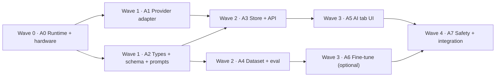

# Swarm Orchestration Playbook — Local AI Strategy Lab

Execution companion to [spec.md](spec.md). Work in dependency waves so parallel subagents modify **disjoint files** and never collide.

> **Windows rule:** run `build`, `lint`, and `test` one after another, never concurrently in separate shells (Vitest/Rolldown `EPERM` lock errors).

```powershell
npm run build ; npm run lint ; npm test
```

---

## 1. Execution DAG



**Hard dependency:** A0 must finish before any production code. It chooses the runtime, model, hardware tier, and whether fine-tuning is allowed.

---

## 2. Conflict-free file ownership

| Workstream | Exclusive owned paths |
|---|---|
| **A0** `runtime-probe` | `docs/adr/0001-local-ai-runtime.md`, `scripts/ai/hardware-probe.ts`, `.scratch/local-ai-strategy-lab/hardware-report.md` |
| **A1** `provider` | `src/server/ai/localModelProvider.ts`, `src/server/ai/localModelProvider.test.ts` |
| **A2** `schema-prompts` | `src/ai/types.ts`, `src/ai/proposalSchema.ts`, `src/server/ai/promptBuilder.ts`, `src/server/ai/promptBuilder.test.ts`, `src/server/ai/proposalSchema.test.ts` |
| **A3** `store-api` | `src/server/ai/proposalStore.ts`, `src/server/ai/proposalApi.test.ts`, `src/server/store/types.ts`, `src/server/store/sqliteStore.ts`, `src/server/store/postgresMigrations.ts`, `src/server/store/postgresStore.ts`, `src/server/botRuntime.ts` |
| **A4** `dataset-eval` | `src/server/ai/datasetBuilder.ts`, `src/server/ai/evalHarness.ts`, `src/server/ai/goldenSet.ts`, `src/server/ai/datasetBuilder.test.ts`, `src/server/ai/evalHarness.test.ts` |
| **A5** `ai-ui` | `src/pages/Training.tsx`, `src/components/training/ai/**`, `src/api/aiClient.ts`, `src/i18n.tsx` |
| **A6** `finetune` | `scripts/ai/finetune/**`, `docs/ai/model-card.md`, `docs/ai/dataset-card.md` |
| **A7** `safety-docs` | `docs/ai/threat-model.md`, `docs/ai/runbook.md`, `docs/adr/0002-ai-proposal-gating.md`, `.env.example`, `.gitignore` |

A3 owns the only shared files (`store/*`, `botRuntime.ts`). No other workstream may edit them.

---

## 3. Copy-ready worker briefs

### Wave 0 — run first, commit the decision

**A0 · `runtime-probe`** (`workspace: "inherit"`)

> Read `.scratch/local-ai-strategy-lab/spec.md` and `package.json`. Do not write production code. Create `scripts/ai/hardware-probe.ts` that reports OS, CPU, RAM, GPU name, VRAM, free disk, and the recommended tier from spec §4.2. Run it, write `.scratch/local-ai-strategy-lab/hardware-report.md`, and create `docs/adr/0001-local-ai-runtime.md` choosing Ollama vs llama.cpp, the model, and whether fine-tuning is allowed. Stop if the hardware is below the CPU-only minimum. Verify `npm run build` and `npm run lint` only. Report the recommended runtime, model, tier, and fine-tune decision.

---

### Wave 1 — merge A0, then launch A1 and A2 in parallel

**A1 · `provider`** (`workspace: "share"`)

> Own ONLY `src/server/ai/localModelProvider.ts` and `src/server/ai/localModelProvider.test.ts`. Read spec §4, §5, §7, §10. Implement a provider interface with `health()`, `chat(messages, opts)`, `embed(texts)`, and `listModels()` for Ollama and an OpenAI-compatible llama.cpp base URL. Add 45 s generation timeout, 10 s health timeout, abort signal, retry only on timeout/429/5xx, and a 3-failure/60 s circuit breaker. Never log prompts, responses, or env values. Tests must use a local mock HTTP server, not a real model. Verify sequentially with `npm run build`, `npm run lint`, `npm test`.

**A2 · `schema-prompts`** (`workspace: "share"`)

> Own ONLY `src/ai/types.ts`, `src/ai/proposalSchema.ts`, `src/server/ai/promptBuilder.ts`, `src/server/ai/promptBuilder.test.ts`, and `src/server/ai/proposalSchema.test.ts`. Read spec §6, §7, §8. Define `AiProposal`, `AiEvalReport`, `AiDatasetManifest`, and the task/status unions. Implement a narrow JSON-schema validator without new dependencies. Implement the deterministic prompt builder with the 6,000-token context budget, untrusted `<context>` delimiters, two few-shot examples, and a maximum of two repair attempts. Reject code, SQL, URLs, unknown fields, and out-of-bounds values. Tests must cover every safety fixture in spec §9.5. Verify sequentially with `npm run build`, `npm run lint`, `npm test`.

---

### Wave 2 — merge Wave 1, verify, then launch A3 and A4 in parallel

**A3 · `store-api`** (`workspace: "share"`)

> Own ONLY `src/server/ai/proposalStore.ts`, `src/server/ai/proposalApi.test.ts`, `src/server/store/types.ts`, `src/server/store/sqliteStore.ts`, `src/server/store/postgresMigrations.ts`, `src/server/store/postgresStore.ts`, and `src/server/botRuntime.ts`. Read spec §6.2, §10 and the existing `strategy_audits` / `runtime_events` patterns. Add the next migration version in both adapters for `ai_models`, `ai_proposals`, `ai_interactions`, `ai_eval_runs`, and `ai_datasets`. Implement the routes in spec §10 with `read:state`, `run:research`, and `trade:execute` permissions. Persist proposals, recompute evaluation with the existing deterministic runner, and write `audit_events` + `runtime_events`. Promotion must call the existing preset promotion path and must reject unless `status=evaluated` and the gate passed. Add an idempotency test for `clientRequestId`. Verify sequentially with `npm run build`, `npm run lint`, `npm test`.

**A4 · `dataset-eval`** (`workspace: "share"`)

> Own ONLY `src/server/ai/datasetBuilder.ts`, `src/server/ai/evalHarness.ts`, `src/server/ai/goldenSet.ts`, `src/server/ai/datasetBuilder.test.ts`, and `src/server/ai/evalHarness.test.ts`. Read spec §8 and §9, plus `src/prediction/mlMetaFilter.ts` and `src/server/store/types.ts`. Build JSONL datasets from real `training_runs` / `strategy_audits` with time-and-preset splits, a SHA-256 manifest, redaction, and a leakage check that rejects any run appearing in two splits. Implement the 50-case golden set (or all available, with `insufficient-data`), the no-AI and RAG baselines, bootstrap 95% CI with 1,000 resamples, and the 20-case safety suite. Never fabricate a run. Verify sequentially with `npm run build`, `npm run lint`, `npm test`.

---

### Wave 3 — merge Wave 2, verify, then launch A5 and A6 in parallel

**A5 · `ai-ui`** (`workspace: "inherit"`)

> Own ONLY `src/pages/Training.tsx`, `src/components/training/ai/**`, `src/api/aiClient.ts`, and `src/i18n.tsx`. Read spec §11 and the existing Training page from the previous spec. Add the AI tab with model status, composer, proposal cards, evaluation panel, eval dashboard, dataset builder, and setup guide. Implement every state in §11.2. `Generate` must be idempotent, `Evaluate` explicit, and `Promote` disabled until the gate passes with a confirmation dialog. Use the existing `Card`, `Tabs`, `Table`, `Badge`, `Dialog`, `format.ts`, and semantic colour tokens. Add EN/ES keys. Verify sequentially with `npm run build`, `npm run lint`, `npm test`.

**A6 · `finetune`** (`workspace: "share"`)

> Optional; start only if A0 approved fine-tuning and A4 produced ≥ 200 labelled examples. Own ONLY `scripts/ai/finetune/**`, `docs/ai/model-card.md`, and `docs/ai/dataset-card.md`. Read spec §4.4, §8, §9. Create a reproducible QLoRA config for the approved base model, a dataset preparation script, an eval script that uses the golden set, and a GGUF export guide. Do not commit weights, adapters, or datasets. Record the base model licence and the exact export commands. Stop and report if the data minimum is not met. Verify the scripts with `npm run build` and `npm run lint`; training itself is an operator-run, offline step.

---

### Wave 4 — merge Wave 3, then A7 and integration

**A7 · `safety-docs`** (`workspace: "inherit"`)

> Own ONLY `docs/ai/threat-model.md`, `docs/ai/runbook.md`, `docs/adr/0002-ai-proposal-gating.md`, `.env.example`, and `.gitignore`. Read spec §12 and the final implementation. Write the threat model with every row in §12 mapped to a control and a test. Write the runbook for: model down, model missing, timeout, invalid output, gate failure, eval regression, secret leak, malicious model file, and disk pressure. Add `FLARE_AI_*` to `.env.example` with safe defaults and no secrets. Add `models/`, `*.gguf`, `*.safetensors`, `adapters/`, and `datasets/*.jsonl` to `.gitignore`. Run the full sequential gate and produce the integration report.

---

## 4. Per-wave acceptance

| Wave | Must be true before merge |
|---|---|
| **0** | Hardware report + ADR committed; runtime/model/fine-tune decision recorded |
| **1** | Provider works against a mock; schema rejects all 20 safety fixtures; prompt hash stable |
| **2** | Migration applies on SQLite and Postgres; proposal persists; eval recomputes metrics; no auto-promotion; dataset split has no leakage |
| **3** | AI tab renders all states; model-down does not break Training; fine-tune is either reproducible or explicitly skipped |
| **4** | Threat model + runbook + `.env.example`; full build/lint/test green; no weights or secrets in `git status` |

---

## 5. Stop conditions

Stop and report instead of guessing when:

- Hardware is below the CPU-only minimum and no fallback model is approved.
- A safety fixture passes through validation.
- Schema validity is below 98% after two repairs.
- The fine-tuned model does not beat the RAG baseline.
- A new dependency is required.
- A change would touch another workstream's files.
- A test, lint, or build failure cannot be fixed inside scope.
- The work would require sending data off the local machine.

---

## 6. Cleanup after the swarm

1. Confirm every shared workstream is merged into `master`.
2. Verify `git status --short` has no weights, datasets, `.env`, or model files.
3. Run `npm run build ; npm run lint ; npm test` sequentially.
4. Record the final eval report and model hash in the spec or ADR.
5. Kill finished workers so no orphaned worktrees remain.
6. Commit only if approved.
